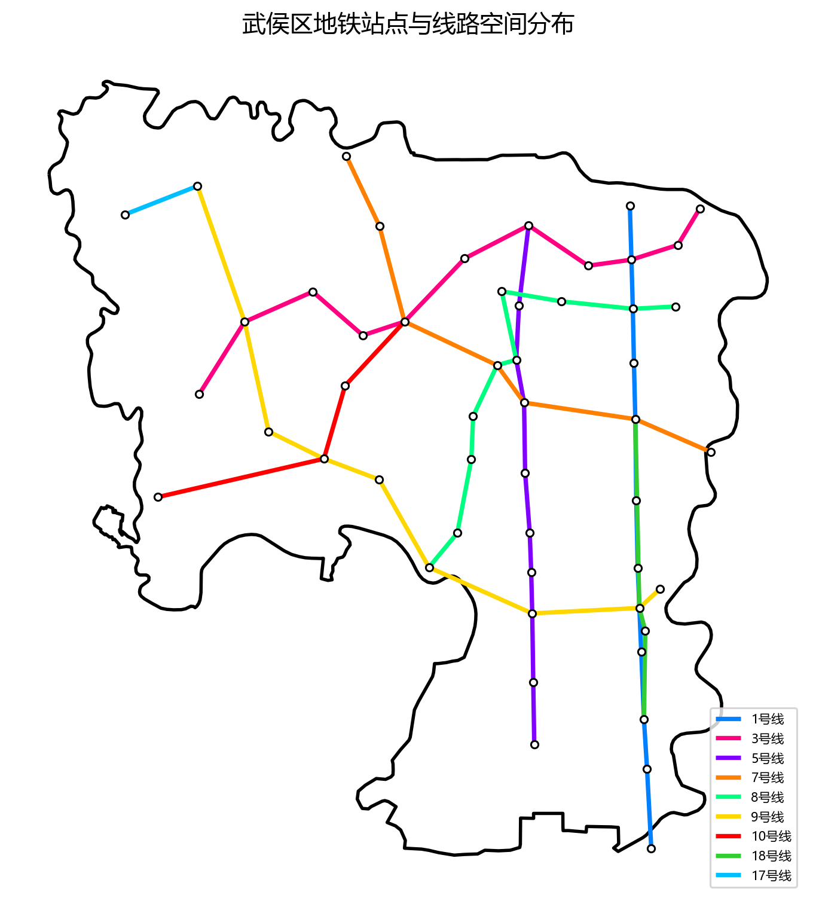
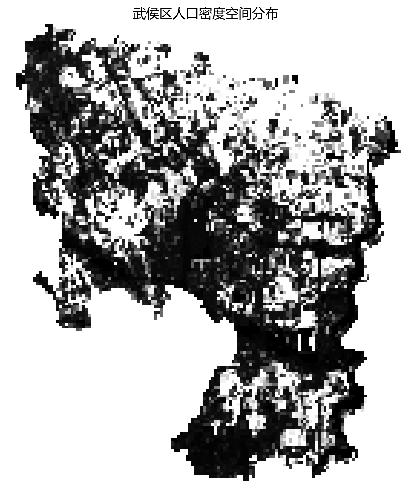
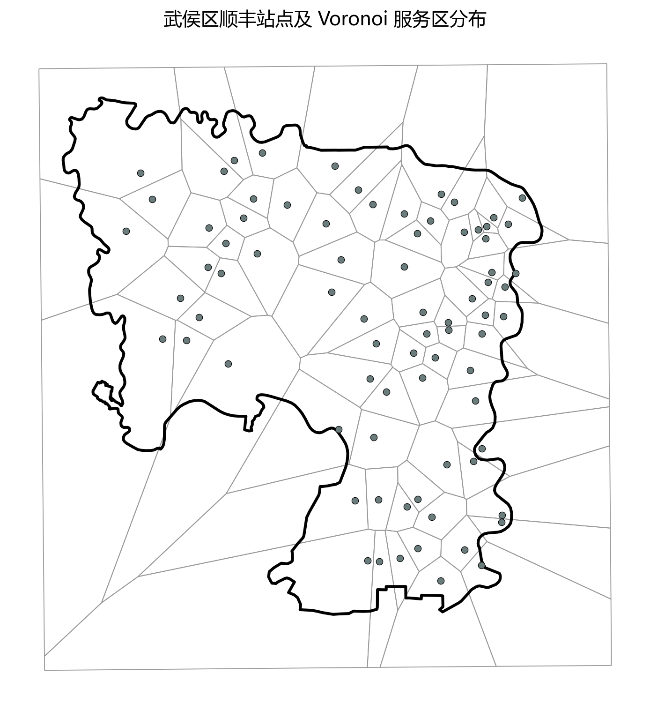
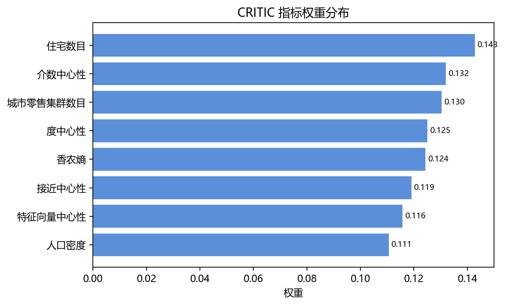
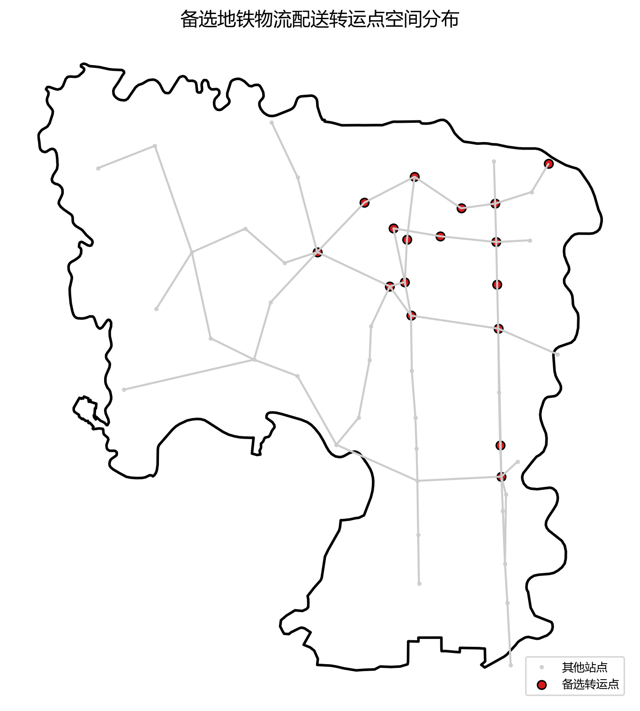
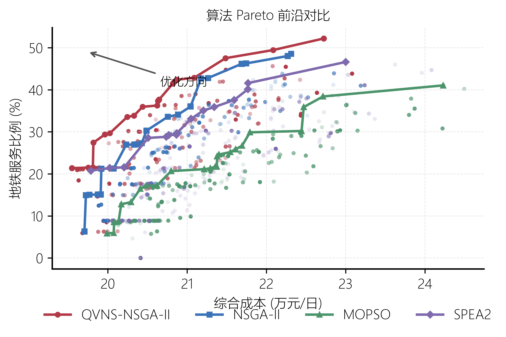
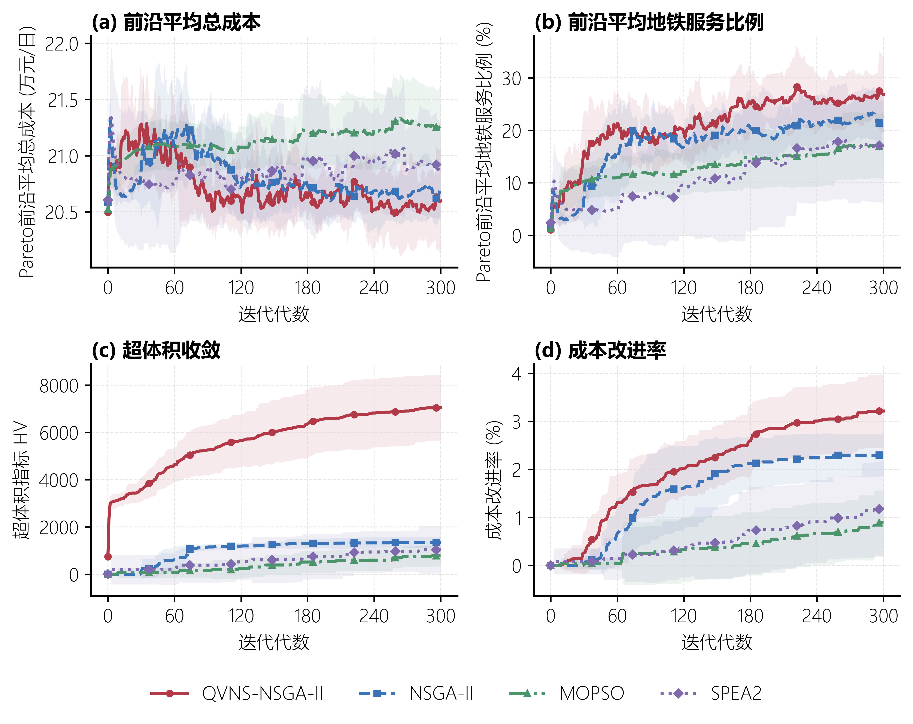
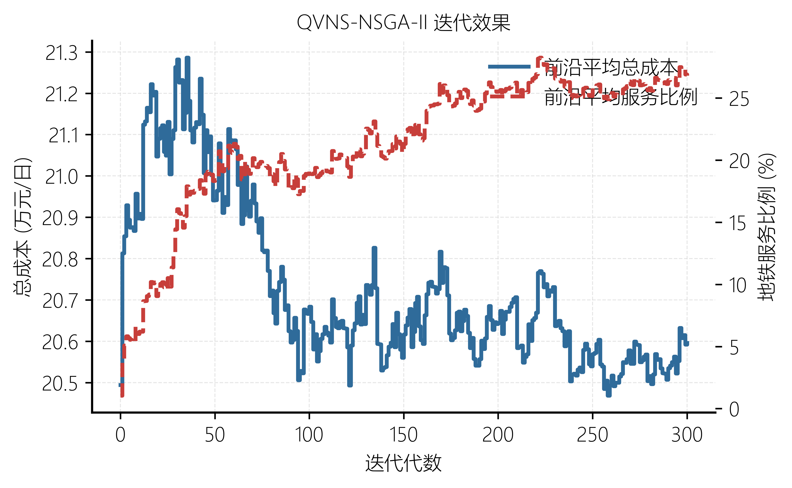
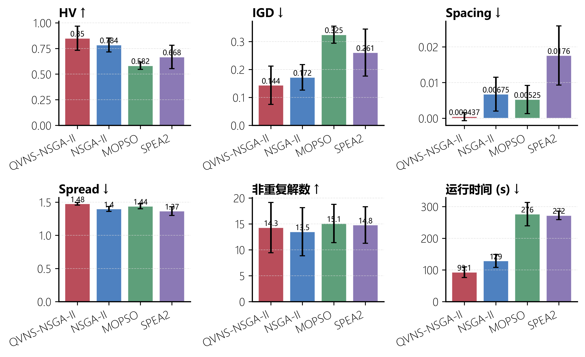
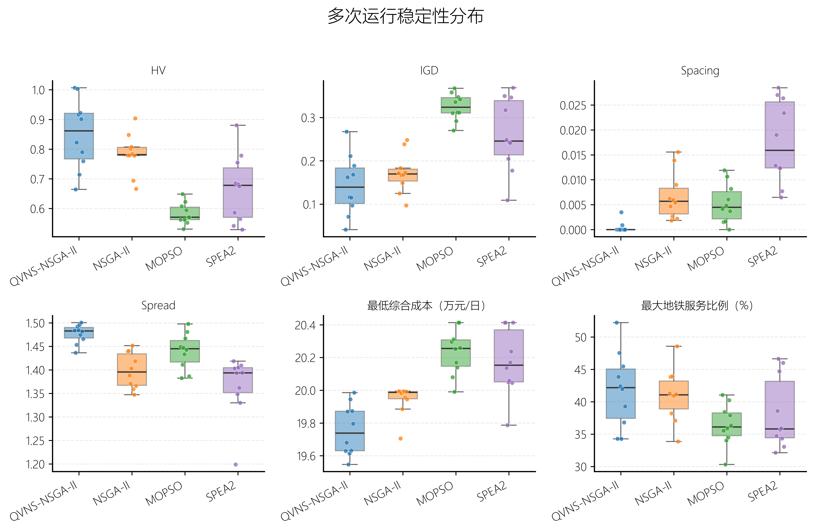

# 第五章 成都市武侯区地铁物流配送转运点布局优化研究



## 5.1 案例区域与数据来源



成都市武侯区位于成都市中心城区南部，是人口、商业、办公、居住和交通功能高度复合的核心城区之一。本章以武侯区为案例区域，围绕“备选地铁物流配送转运点识别—地铁物流配送转运点布局优化—结果分析与敏感性检验”的逻辑展开，验证本文所构建模型与算法在中心城区地铁物流场景中的适用性。



本章地铁站点基础数据采集时间为 2024 年 10 月，数据内容包括武侯区范围内 51 个地铁站点的站点名称、所属线路、经纬度、换乘属性、线路数量和地址信息。研究区域共涉及地铁 1 号线、3 号线、5 号线、7 号线、8 号线、9 号线、10 号线、17 号线和 18 号线等 9 条线路，其中换乘站 15 个，非换乘站 36 个。



**表 5-1 武侯区地铁网络基础统计**



| 项目 | 统计结果 |

| --- | --- |

| 地铁站点数量 | 51 个 |

| 涉及线路数量 | 9 条 |

| 换乘站数量 | 15 个 |

| 非换乘站数量 | 36 个 |

| 单线站数量 | 36 个 |

| 双线站数量 | 12 个 |

| 三线站数量 | 3 个 |

| 数据采集时间 | 2024 年 10 月 |







图 5-1 武侯区地铁站点与线路空间分布图



由图 5-1 可见，武侯区地铁站点在空间上呈现中心城区高密度集聚、南部商务与产业片区延伸、西部及西南片区多线路衔接的特征。多线路交汇站点具有较强的干线运输组织能力，居住、商业和产业功能集聚区附近站点则具有较高的末端需求承接潜力。







图 5-2 武侯区人口密度空间分布图



为刻画案例区域内潜在生活性物流需求，本文引入人口密度空间数据。由图 5-2 可见，武侯区人口密度在空间上呈现明显不均衡特征，人口高密度区域主要集中于北部、东北部和中东部建成区。这些区域居住功能、商业服务和公共服务设施相对密集，具有较强的快递收派和即时配送需求基础。







图 5-3 武侯区顺丰站点及 Voronoi 服务区分布图



末端快递服务网点的空间分布是刻画城市物流需求组织格局的重要依据。本文以武侯区 78 个顺丰末端站点作为末端配送需求节点，并基于站点空间位置构建 Voronoi 服务区，用于近似表征各顺丰站点的空间服务范围。图 5-3 表明，中心城区及东部片区顺丰站点分布较为密集，Voronoi 单元面积较小；西部、西南部及边缘区域站点分布相对稀疏，服务区面积较大。



## 5.2 第一阶段：备选地铁物流配送转运点识别



### 5.2.1 指标体系与数据处理



第一阶段的目标是在武侯区全部地铁站点中识别具有物流转运潜力的备选站点。本文沿用第三章构建的网络结构与需求潜力协同评价框架，从地铁网络拓扑中心性和站域需求潜力两个维度对武侯区 51 个地铁站点进行综合评价。网络结构维度包括度中心性、介数中心性、接近中心性和特征向量中心性；需求潜力维度包括人口密度、住宅数量、城市零售集群数量和功能结构混合度。



**表 5-2 评价指标描述性统计结果**



| 指标 | 最小值 | 最大值 | 均值 | 标准差 |

| --- | --- | --- | --- | --- |

| 度中心性 | 0.0200 | 0.1200 | 0.0471 | 0.0243 |

| 介数中心性 | 0.0000 | 0.3037 | 0.0825 | 0.0810 |

| 接近中心性 | 0.0834 | 0.1974 | 0.1451 | 0.0261 |

| 特征向量中心性 | 0.0000 | 0.6122 | 0.0554 | 0.1299 |

| 人口密度 | 4515.4700 | 45683.7000 | 16960.5539 | 7964.7816 |

| 住宅数目 | 3.0000 | 300.0000 | 95.2745 | 82.9431 |

| 城市零售集群数目 | 0.0000 | 8.0000 | 2.4314 | 1.6764 |

| 香农熵 | 0.6560 | 0.9633 | 0.8397 | 0.0695 |



### 5.2.2 CRITIC 权重计算结果



在指标标准化基础上，本文采用 CRITIC 方法确定各评价指标权重。CRITIC 方法同时考虑指标的对比强度和指标间冲突性，能够较好反映指标本身所包含的信息量，避免完全依赖主观经验确定权重。



**表 5-3 地铁物流配送转运点综合评价指标权重**



| 指标 | 权重 | 权重占比 |

| --- | --- | --- |

| 度中心性 | 0.1251 | 12.51% |

| 介数中心性 | 0.1320 | 13.20% |

| 接近中心性 | 0.1191 | 11.91% |

| 特征向量中心性 | 0.1157 | 11.57% |

| 人口密度 | 0.1106 | 11.06% |

| 住宅数目 | 0.1428 | 14.28% |

| 城市零售集群数目 | 0.1304 | 13.04% |

| 香农熵 | 0.1244 | 12.44% |







图 5-4 CRITIC 指标权重分布图



由表 5-3 和图 5-4 可知，8 个指标权重整体较为均衡，说明地铁物流配送转运点识别需要综合考虑网络结构和站域需求潜力。其中，住宅数量权重最高，为 0.1428；介数中心性和城市零售集群数量权重分别为 0.1320 和 0.1304，表明站点网络桥接作用和商业消费设施集聚程度同样是影响转运点适宜性的重要因素。



### 5.2.3 TOPSIS 综合评价与排序结果



在确定指标权重后，本文采用 TOPSIS 方法计算各站点的综合贴近度。综合贴近度越高，说明该站点在网络结构和需求潜力两方面越接近理想状态，越适合作为后续布局优化模型的候选站点。



**表 5-4 武侯区 51 个地铁站点综合贴近度排序结果**



| 排名 | 站点 | 综合贴近度 | 排名 | 站点 | 综合贴近度 | 排名 | 站点 | 综合贴近度 |

| --- | --- | --- | --- | --- | --- | --- | --- | --- |

| 1 | 高朋大道 | 0.5700 | 18 | 川大望江校区 | 0.2835 | 35 | 锦城广场 | 0.2115 |

| 2 | 九兴大道 | 0.5393 | 19 | 华西坝 | 0.2823 | 36 | 石羊立交 | 0.2111 |

| 3 | 火车南站 | 0.4837 | 20 | 锦城大道 | 0.2811 | 37 | 三元 | 0.2085 |

| 4 | 神仙树 | 0.4761 | 21 | 武青南路 | 0.2770 | 38 | 龙爪堰 | 0.2071 |

| 5 | 高升桥 | 0.4542 | 22 | 世纪城 | 0.2746 | 39 | 锦城湖 | 0.1718 |

| 6 | 省体育馆 | 0.4440 | 23 | 簇锦 | 0.2616 | 40 | 心岛 | 0.1714 |

| 7 | 孵化园 | 0.4141 | 24 | 交子大道 | 0.2586 | 41 | 锦城广场东 | 0.1644 |

| 8 | 倪家桥 | 0.4058 | 25 | 高新 | 0.2583 | 42 | 机投桥 | 0.1614 |

| 9 | 太平园 | 0.4003 | 26 | 磨子桥 | 0.2508 | 43 | 双凤桥 | 0.1537 |

| 10 | 衣冠庙 | 0.3864 | 27 | 市一医院 | 0.2505 | 44 | 天府三街 | 0.1472 |

| 11 | 红牌楼 | 0.3425 | 28 | 华兴 | 0.2468 | 45 | 三瓦窑 | 0.1455 |

| 12 | 新南门 | 0.3366 | 29 | 殷家林 | 0.2464 | 46 | 庆安 | 0.1452 |

| 13 | 芳草街 | 0.3334 | 30 | 武侯大道 | 0.2417 | 47 | 太平寺 | 0.1390 |

| 14 | 科园 | 0.3178 | 31 | 武侯立交 | 0.2414 | 48 | 石羊 | 0.1223 |

| 15 | 桐梓林 | 0.3113 | 32 | 大源 | 0.2401 | 49 | 天府五街 | 0.1157 |

| 16 | 永丰 | 0.3058 | 33 | 川藏立交 | 0.2179 | 50 | 白佛桥 | 0.0755 |

| 17 | 金融城 | 0.2980 | 34 | 簇桥 | 0.2177 | 51 | 金花 | 0.0471 |



由表 5-4 可知，武侯区地铁站点综合贴近度呈现明显梯度分布。高朋大道、九兴大道、火车南站、神仙树、高升桥、省体育馆、孵化园、倪家桥、太平园和衣冠庙等站点位居前列，说明这些站点或具有较强的线路组织能力，或靠近人口、居住和商业活动较为集聚的区域，具备较高的地铁物流转运潜力。



### 5.2.4 备选转运点筛选与参数设定



为在保证候选点质量的同时控制后续优化模型规模，本文按综合贴近度由高到低选取排名前 17 位的站点作为备选地铁物流配送转运点集合。候选集合包括 3 个枢纽站、6 个换乘站和 8 个小型站，并根据站点类型设置处理能力和固定启用成本。



**表 5-5 备选地铁物流配送转运点类型与参数设定**



| 排名 | 站点名称 | 综合贴近度 | 类型 | 处理能力（件/日） | 固定启用成本（元/日） |

| --- | --- | --- | --- | --- | --- |

| 1 | 高朋大道 | 0.5700 | TR | 7000 | 12000 |

| 2 | 九兴大道 | 0.5393 | TR | 7000 | 12000 |

| 3 | 火车南站 | 0.4837 | HB | 10000 | 16000 |

| 4 | 神仙树 | 0.4761 | TR | 7000 | 12000 |

| 5 | 高升桥 | 0.4542 | TR | 7000 | 12000 |

| 6 | 省体育馆 | 0.4440 | TR | 7000 | 12000 |

| 7 | 孵化园 | 0.4141 | HB | 10000 | 16000 |

| 8 | 倪家桥 | 0.4058 | TR | 7000 | 12000 |

| 9 | 太平园 | 0.4003 | HB | 10000 | 16000 |

| 10 | 衣冠庙 | 0.3864 | SL | 5000 | 8000 |

| 11 | 红牌楼 | 0.3425 | SL | 5000 | 8000 |

| 12 | 新南门 | 0.3366 | SL | 5000 | 8000 |

| 13 | 芳草街 | 0.3334 | SL | 5000 | 8000 |

| 14 | 科园 | 0.3178 | SL | 5000 | 8000 |

| 15 | 桐梓林 | 0.3113 | SL | 5000 | 8000 |

| 16 | 永丰 | 0.3058 | SL | 5000 | 8000 |

| 17 | 金融城 | 0.2980 | SL | 5000 | 8000 |







图 5-5 备选地铁物流配送转运点空间分布图



从空间分布看，备选转运点主要分布于武侯区中心城区换乘节点、南部商务和产业功能片区以及西南部对外衔接节点。该候选集合兼顾了网络组织效率、站域需求潜力和空间覆盖能力，为第二阶段布局优化提供了可行决策空间。



## 5.3 第二阶段：地铁物流配送转运点布局优化



### 5.3.1 末端需求点与需求量测算



本章将武侯区内顺丰末端站点作为第二阶段选址—分配模型的需求点。基于高德地图 POI 数据清洗结果，共整理得到 78 个有效顺丰末端站点，字段包括站点名称、地址、经纬度、类型、评分和数据来源等信息。为刻画各末端站点的潜在服务范围，本文以顺丰站点空间位置为生成点构建 Voronoi 服务区，并假设各顺丰站点主要服务其 Voronoi 单元范围内的末端配送需求。



在此基础上，叠加人口栅格数据统计各 Voronoi 服务区内的人口规模，并将服务区人口作为需求权重，对武侯区顺丰日均配送总需求量进行比例分配。该方法的基本假设是：在缺少站点真实收派件量数据的情况下，末端快递需求与服务区内人口规模近似成正比。人口规模越大，居民日常消费、快递收派和即时配送活动越频繁，对应顺丰站点的潜在需求量也越高。



**表 5-6 顺丰末端需求量描述性统计**



| 项目 | 数值 |

| --- | --- |

| 需求点数量 | 78 |

| 基准情景总需求量 | 66970.02 件/日 |

| 平均需求量 | 858.59 件/日 |

| 最小需求量 | 116.35 件/日 |

| 最大需求量 | 3124.49 件/日 |

| 标准差 | 538.72 件/日 |

| 服务人口总量 | 1902819.83 |

| Voronoi 平均面积 | 3.7131 km² |



**表 5-7 高需求顺丰末端站点**



| 排名 | 站点名称 | 服务人口规模 | 需求量（件/日） |

| --- | --- | --- | --- |

| 1 | 顺丰速运(簇锦家园店) | 88776.24 | 3124.49 |

| 2 | 顺丰速运(金花店) | 72895.22 | 2565.56 |

| 3 | 顺丰速运(机投镇店) | 61744.64 | 2173.11 |

| 4 | 顺丰速运(芳草街店) | 58634.73 | 2063.66 |

| 5 | 顺丰速运(武青西四路店) | 46697.00 | 1643.51 |

| 6 | 顺丰速运(双丰西路店) | 43996.82 | 1548.47 |

| 7 | 顺丰速运(长益路店) | 42949.43 | 1511.61 |

| 8 | 顺丰速运(永盛路店) | 40158.31 | 1413.38 |

| 9 | 顺丰速运(天街枫香庭店) | 37965.93 | 1336.22 |

| 10 | 顺丰速运(纳米爱邸店) | 37623.37 | 1324.16 |



根据需求测算结果，基准情景下武侯区顺丰日均配送需求量为 66970.02 件/日，78 个需求点的平均需求量为 858.59 件/日，最小值为 116.35 件/日，最大值为 3124.49 件/日，标准差为 538.72 件/日，说明末端配送需求在空间上具有较明显的不均衡性。高需求站点主要分布于簇桥、金花、机投桥、芳草街和红牌楼等片区，反映出上述区域较强的末端物流需求强度。



### 5.3.2 模型输入与优化思路



第二阶段模型以 17 个候选转运点、78 个顺丰末端需求点、物流园区货源点、地铁线网距离、道路接驳距离、站点处理能力和成本参数为输入。模型目标包括综合物流成本最小化和地铁服务比例最大化，其中综合成本包括站点固定启用成本、道路接驳成本、地铁运输成本、换乘处理成本和末端配送相关成本。



在算法求解方面，本文采用 QVNS-NSGA-II 对双目标布局优化模型进行求解，并与 NSGA-II、MOPSO 和 SPEA2 等典型多目标优化算法进行对比。评价指标包括 Pareto 前沿分布、收敛过程、HV、IGD、运行时间和多次运行稳定性等。







图 5-6 典型多目标优化算法 Pareto 前沿对比







图 5-7 四种算法收敛过程对比







图 5-8 QVNS-NSGA-II 迭代效果







图 5-9 四种算法性能指标对比







图 5-10 多次运行稳定性分布



算法对比结果表明，QVNS-NSGA-II 在 HV、IGD、运行时间和多次运行稳定性方面具有综合优势，能够在可接受计算时间内获得质量更高、分布更稳定的 Pareto 前沿。与 SPEA2 等典型多目标优化算法相比，QVNS-NSGA-II 能够更好地平衡全局搜索、局部邻域改进和非支配解维护。



## 5.4 结果分析与实际应用讨论



从实际应用角度看，地铁物流转运点布局不仅需要满足模型计算结果，还需要考虑站内空间条件、平峰期作业窗口、客流干扰、安全管理、货物装卸组织和与快递企业运营网络的协同。枢纽站适合承担跨线路和跨片区货流组织任务，换乘站适合作为地铁物流系统的核心转运节点，小型站则可服务局部高密度居住或商业片区。



人口密度图和顺丰站点 Voronoi 服务区图进一步说明，武侯区末端物流需求具有明显空间异质性。布局方案应兼顾高需求片区的接驳效率与边缘片区的服务覆盖能力，避免仅在中心高密度区域布设转运点而忽略外围片区配送可达性。



## 5.5 本章小结



本章以成都市武侯区为案例区域，基于 2024 年 10 月采集的地铁站点与线路数据，整理得到 51 个地铁站点、9 条地铁线路和 15 个换乘站的基础网络。通过引入人口密度、顺丰末端站点及 Voronoi 服务区等数据，进一步刻画了研究区域内潜在物流需求的空间分布特征。



在第一阶段，本文采用 CRITIC-TOPSIS 方法对 51 个地铁站点进行综合评价，选取排名前 17 位的站点作为备选地铁物流配送转运点集合。候选集合包括 3 个枢纽站、6 个换乘站和 8 个小型站，兼顾了网络组织能力、站域需求潜力和空间覆盖能力。在第二阶段，本文以 78 个顺丰末端站点作为需求点，基于 Voronoi 服务区人口规模测算需求量，并构建地铁物流配送转运点布局优化模型。算法对比结果表明，QVNS-NSGA-II 在求解质量、收敛表现、运行时间和稳定性方面具有综合优势。



总体而言，本章形成了从“站点重要度评价”到“候选点筛选”再到“选址—分配优化”的完整实证链条，为成都市中心城区地铁物流配送转运点规划提供了定量化方法支撑。

